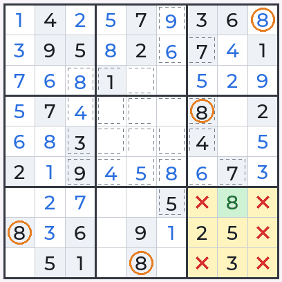

<!-- Written by tools/walkthrough.py sumless-killer: edit the script, not this page. -->
# Sumless Killer, step 31: the 8 in box 9

**Step 31 of 53** · [← Step 30](step-30.md) · [All steps](../sumless-killer.md#the-whole-puzzle-step-by-step) · [Step 32 →](step-32.md)

Box 9 needs an 8. r7c7: column 7 has one (r4c7). r7c9: column 9 has one (r1c9). r8c9: row 8 has one (r8c1). r9c7 and r9c9: row 9 has one (r9c5). Only **r7c8** is left: **r7c8 = 8**.

**Step 31 of 53** · [← Step 30](step-30.md) · [All steps](../sumless-killer.md#the-whole-puzzle-step-by-step) · [Step 32 →](step-32.md)
