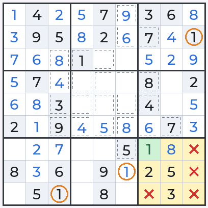

<!-- Written by tools/walkthrough.py sumless-killer: edit the script, not this page. -->
# Sumless Killer, step 32: the 1 in box 9

**Step 32 of 53** · [← Step 31](step-31.md) · [All steps](../sumless-killer.md#the-whole-puzzle-step-by-step) · [Step 33 →](step-33.md)

Box 9 needs a 1. r7c9: column 9 has one (r2c9). r8c9: row 8 has one (r8c6). r9c7 and r9c9: row 9 has one (r9c3). Only **r7c7** is left: **r7c7 = 1**.

**Step 32 of 53** · [← Step 31](step-31.md) · [All steps](../sumless-killer.md#the-whole-puzzle-step-by-step) · [Step 33 →](step-33.md)
