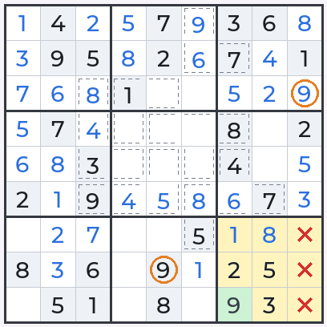

<!-- Written by tools/walkthrough.py sumless-killer: edit the script, not this page. -->
# Sumless Killer, step 33: the 9 in box 9

**Step 33 of 53** · [← Step 32](step-32.md) · [All steps](../sumless-killer.md#the-whole-puzzle-step-by-step) · [Step 34 →](step-34.md)

Box 9 needs a 9. r7c9 and r9c9: column 9 has one (r3c9). r8c9: row 8 has one (r8c5). Only **r9c7** is left: **r9c7 = 9**.

**Step 33 of 53** · [← Step 32](step-32.md) · [All steps](../sumless-killer.md#the-whole-puzzle-step-by-step) · [Step 34 →](step-34.md)
