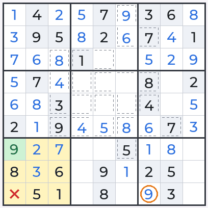

<!-- Written by tools/walkthrough.py sumless-killer: edit the script, not this page. -->
# Sumless Killer, step 34: the 9 in box 7

**Step 34 of 53** · [← Step 33](step-33.md) · [All steps](../sumless-killer.md#the-whole-puzzle-step-by-step) · [Step 35 →](step-35.md)

Box 7 needs a 9. r9c1: row 9 has one (r9c7). Only **r7c1** is left: **r7c1 = 9**.

**Step 34 of 53** · [← Step 33](step-33.md) · [All steps](../sumless-killer.md#the-whole-puzzle-step-by-step) · [Step 35 →](step-35.md)
