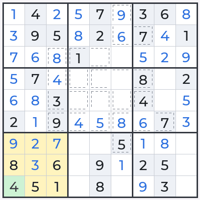

<!-- Written by tools/walkthrough.py sumless-killer: edit the script, not this page. -->
# Sumless Killer, step 35: the 4 in box 7

**Step 35 of 53** · [← Step 34](step-34.md) · [All steps](../sumless-killer.md#the-whole-puzzle-step-by-step) · [Step 36 →](step-36.md)

Box 7 needs a 4, and r9c1 is its last empty cell: **r9c1 = 4**.

**Step 35 of 53** · [← Step 34](step-34.md) · [All steps](../sumless-killer.md#the-whole-puzzle-step-by-step) · [Step 36 →](step-36.md)
