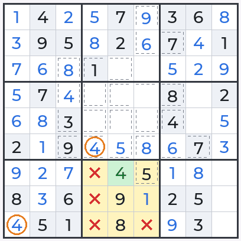

<!-- Written by tools/walkthrough.py sumless-killer: edit the script, not this page. -->
# Sumless Killer, step 36: the 4 in box 8

**Step 36 of 53** · [← Step 35](step-35.md) · [All steps](../sumless-killer.md#the-whole-puzzle-step-by-step) · [Step 37 →](step-37.md)

Box 8 needs a 4. r7c4 and r8c4: column 4 has one (r6c4). r9c4 and r9c6: row 9 has one (r9c1). Only **r7c5** is left: **r7c5 = 4**.

**Step 36 of 53** · [← Step 35](step-35.md) · [All steps](../sumless-killer.md#the-whole-puzzle-step-by-step) · [Step 37 →](step-37.md)
