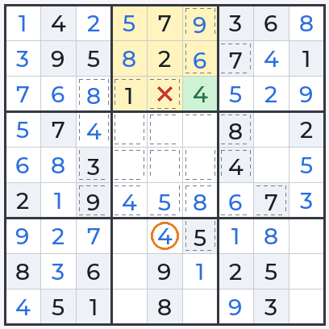

<!-- Written by tools/walkthrough.py sumless-killer: edit the script, not this page. -->
# Sumless Killer, step 37: the 4 in box 2

**Step 37 of 53** · [← Step 36](step-36.md) · [All steps](../sumless-killer.md#the-whole-puzzle-step-by-step) · [Step 38 →](step-38.md)

Box 2 needs a 4. r3c5: column 5 has one (r7c5). Only **r3c6** is left: **r3c6 = 4**.

**Step 37 of 53** · [← Step 36](step-36.md) · [All steps](../sumless-killer.md#the-whole-puzzle-step-by-step) · [Step 38 →](step-38.md)
