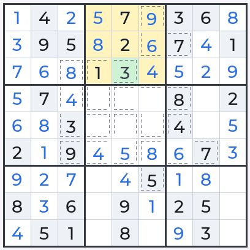

<!-- Written by tools/walkthrough.py sumless-killer: edit the script, not this page. -->
# Sumless Killer, step 38: the 3 in box 2

**Step 38 of 53** · [← Step 37](step-37.md) · [All steps](../sumless-killer.md#the-whole-puzzle-step-by-step) · [Step 39 →](step-39.md)

Box 2 needs a 3, and r3c5 is its last empty cell: **r3c5 = 3**.

**Step 38 of 53** · [← Step 37](step-37.md) · [All steps](../sumless-killer.md#the-whole-puzzle-step-by-step) · [Step 39 →](step-39.md)
