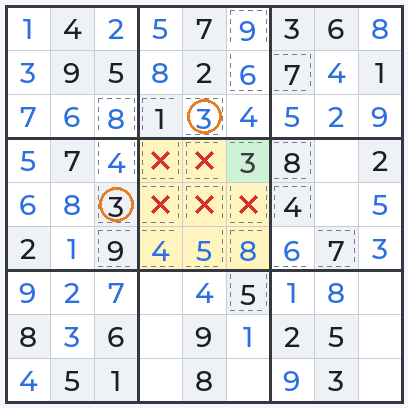

<!-- Written by tools/walkthrough.py sumless-killer: edit the script, not this page. -->
# Sumless Killer, step 39: the 3 in box 5

**Step 39 of 53** · [← Step 38](step-38.md) · [All steps](../sumless-killer.md#the-whole-puzzle-step-by-step) · [Step 40 →](step-40.md)

Box 5 needs a 3. r4c4: the 3 in r3c5 is in the same cage. r4c5: column 5 has one (r3c5). r5c4, r5c5 and r5c6: row 5 has one (r5c3). Only **r4c6** is left: **r4c6 = 3**.

**Step 39 of 53** · [← Step 38](step-38.md) · [All steps](../sumless-killer.md#the-whole-puzzle-step-by-step) · [Step 40 →](step-40.md)
