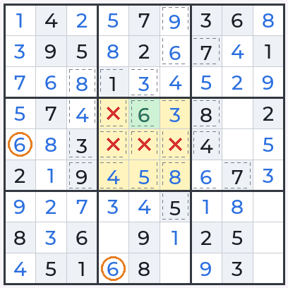

<!-- Written by tools/walkthrough.py sumless-killer: edit the script, not this page. -->
# Sumless Killer, step 42: the 6 in box 5

**Step 42 of 53** · [← Step 41](step-41.md) · [All steps](../sumless-killer.md#the-whole-puzzle-step-by-step) · [Step 43 →](step-43.md)

Box 5 needs a 6. r4c4: column 4 has one (r9c4). r5c4, r5c5 and r5c6: row 5 has one (r5c1). Only **r4c5** is left: **r4c5 = 6**.

**Step 42 of 53** · [← Step 41](step-41.md) · [All steps](../sumless-killer.md#the-whole-puzzle-step-by-step) · [Step 43 →](step-43.md)
