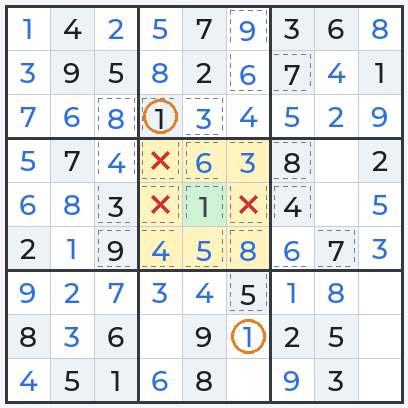

<!-- Written by tools/walkthrough.py sumless-killer: edit the script, not this page. -->
# Sumless Killer, step 43: the 1 in box 5

**Step 43 of 53** · [← Step 42](step-42.md) · [All steps](../sumless-killer.md#the-whole-puzzle-step-by-step) · [Step 44 →](step-44.md)

Box 5 needs a 1. r4c4 and r5c4: column 4 has one (r3c4). r5c6: column 6 has one (r8c6). Only **r5c5** is left: **r5c5 = 1**.

**Step 43 of 53** · [← Step 42](step-42.md) · [All steps](../sumless-killer.md#the-whole-puzzle-step-by-step) · [Step 44 →](step-44.md)
