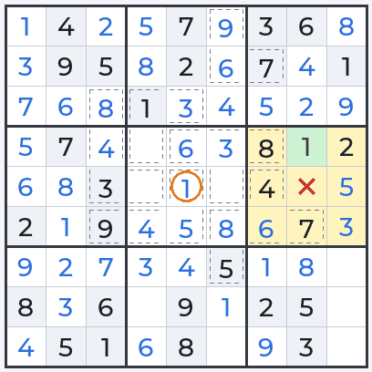

<!-- Written by tools/walkthrough.py sumless-killer: edit the script, not this page. -->
# Sumless Killer, step 44: the 1 in box 6

**Step 44 of 53** · [← Step 43](step-43.md) · [All steps](../sumless-killer.md#the-whole-puzzle-step-by-step) · [Step 45 →](step-45.md)

Box 6 needs a 1. r5c8: row 5 has one (r5c5). Only **r4c8** is left: **r4c8 = 1**.

**Step 44 of 53** · [← Step 43](step-43.md) · [All steps](../sumless-killer.md#the-whole-puzzle-step-by-step) · [Step 45 →](step-45.md)
