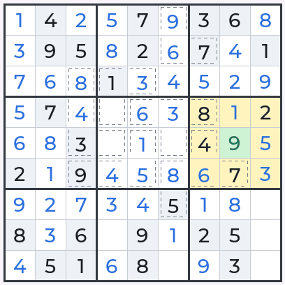

<!-- Written by tools/walkthrough.py sumless-killer: edit the script, not this page. -->
# Sumless Killer, step 45: the 9 in box 6

**Step 45 of 53** · [← Step 44](step-44.md) · [All steps](../sumless-killer.md#the-whole-puzzle-step-by-step) · [Step 46 →](step-46.md)

Box 6 needs a 9, and r5c8 is its last empty cell: **r5c8 = 9**.

**Step 45 of 53** · [← Step 44](step-44.md) · [All steps](../sumless-killer.md#the-whole-puzzle-step-by-step) · [Step 46 →](step-46.md)
