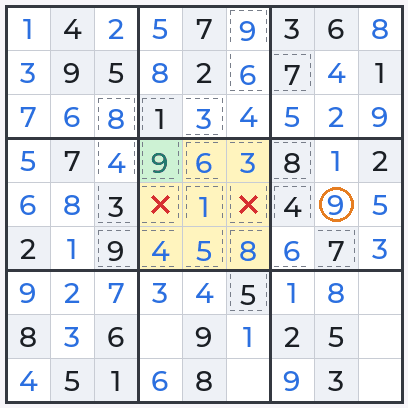

<!-- Written by tools/walkthrough.py sumless-killer: edit the script, not this page. -->
# Sumless Killer, step 46: the 9 in box 5

**Step 46 of 53** · [← Step 45](step-45.md) · [All steps](../sumless-killer.md#the-whole-puzzle-step-by-step) · [Step 47 →](step-47.md)

Box 5 needs a 9. r5c4 and r5c6: row 5 has one (r5c8). Only **r4c4** is left: **r4c4 = 9**.

**Step 46 of 53** · [← Step 45](step-45.md) · [All steps](../sumless-killer.md#the-whole-puzzle-step-by-step) · [Step 47 →](step-47.md)
