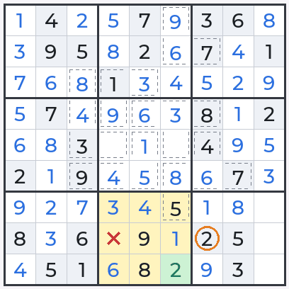

<!-- Written by tools/walkthrough.py sumless-killer: edit the script, not this page. -->
# Sumless Killer, step 47: the 2 in box 8

**Step 47 of 53** · [← Step 46](step-46.md) · [All steps](../sumless-killer.md#the-whole-puzzle-step-by-step) · [Step 48 →](step-48.md)

Box 8 needs a 2. r8c4: row 8 has one (r8c7). Only **r9c6** is left: **r9c6 = 2**.

**Step 47 of 53** · [← Step 46](step-46.md) · [All steps](../sumless-killer.md#the-whole-puzzle-step-by-step) · [Step 48 →](step-48.md)
