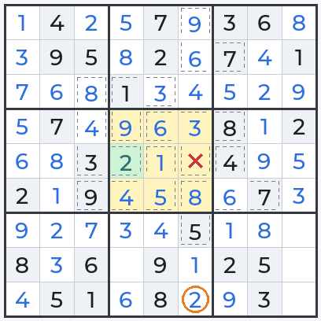

<!-- Written by tools/walkthrough.py sumless-killer: edit the script, not this page. -->
# Sumless Killer, step 48: the 2 in box 5

**Step 48 of 53** · [← Step 47](step-47.md) · [All steps](../sumless-killer.md#the-whole-puzzle-step-by-step) · [Step 49 →](step-49.md)

Box 5 needs a 2. r5c6: column 6 has one (r9c6). Only **r5c4** is left: **r5c4 = 2**.

**Step 48 of 53** · [← Step 47](step-47.md) · [All steps](../sumless-killer.md#the-whole-puzzle-step-by-step) · [Step 49 →](step-49.md)
