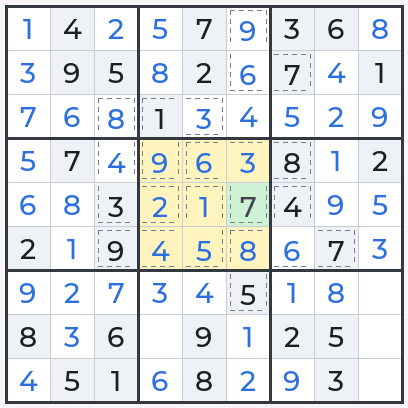

<!-- Written by tools/walkthrough.py sumless-killer: edit the script, not this page. -->
# Sumless Killer, step 49: the 7 in box 5

**Step 49 of 53** · [← Step 48](step-48.md) · [All steps](../sumless-killer.md#the-whole-puzzle-step-by-step) · [Step 50 →](step-50.md)

Box 5 needs a 7, and r5c6 is its last empty cell: **r5c6 = 7**.

**Step 49 of 53** · [← Step 48](step-48.md) · [All steps](../sumless-killer.md#the-whole-puzzle-step-by-step) · [Step 50 →](step-50.md)
