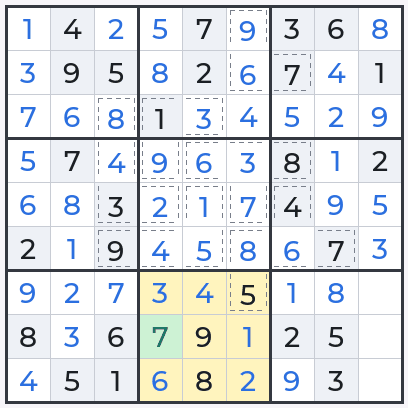

<!-- Written by tools/walkthrough.py sumless-killer: edit the script, not this page. -->
# Sumless Killer, step 50: the 7 in box 8

**Step 50 of 53** · [← Step 49](step-49.md) · [All steps](../sumless-killer.md#the-whole-puzzle-step-by-step) · [Step 51 →](step-51.md)

Box 8 needs a 7, and r8c4 is its last empty cell: **r8c4 = 7**.

**Step 50 of 53** · [← Step 49](step-49.md) · [All steps](../sumless-killer.md#the-whole-puzzle-step-by-step) · [Step 51 →](step-51.md)
