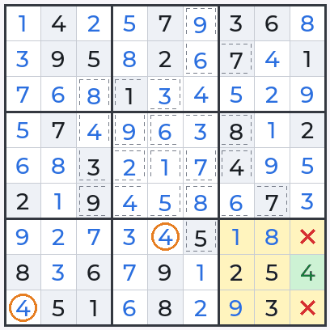

<!-- Written by tools/walkthrough.py sumless-killer: edit the script, not this page. -->
# Sumless Killer, step 51: the 4 in box 9

**Step 51 of 53** · [← Step 50](step-50.md) · [All steps](../sumless-killer.md#the-whole-puzzle-step-by-step) · [Step 52 →](step-52.md)

Box 9 needs a 4. r7c9: row 7 has one (r7c5). r9c9: row 9 has one (r9c1). Only **r8c9** is left: **r8c9 = 4**.

**Step 51 of 53** · [← Step 50](step-50.md) · [All steps](../sumless-killer.md#the-whole-puzzle-step-by-step) · [Step 52 →](step-52.md)
