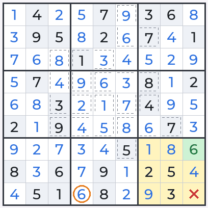

<!-- Written by tools/walkthrough.py sumless-killer: edit the script, not this page. -->
# Sumless Killer, step 52: the 6 in box 9

**Step 52 of 53** · [← Step 51](step-51.md) · [All steps](../sumless-killer.md#the-whole-puzzle-step-by-step) · [Step 53 →](step-53.md)

Box 9 needs a 6. r9c9: row 9 has one (r9c4). Only **r7c9** is left: **r7c9 = 6**.

**Step 52 of 53** · [← Step 51](step-51.md) · [All steps](../sumless-killer.md#the-whole-puzzle-step-by-step) · [Step 53 →](step-53.md)
