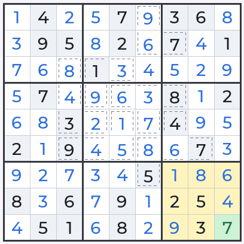

<!-- Written by tools/walkthrough.py sumless-killer: edit the script, not this page. -->
# Sumless Killer, step 53: the 7 in box 9

**Step 53 of 53** · [← Step 52](step-52.md) · [All steps](../sumless-killer.md#the-whole-puzzle-step-by-step) · [All steps](../sumless-killer.md#the-whole-puzzle-step-by-step)

Box 9 needs a 7, and r9c9 is its last empty cell: **r9c9 = 7**.

Solved.

**Step 53 of 53** · [← Step 52](step-52.md) · [All steps](../sumless-killer.md#the-whole-puzzle-step-by-step) · [All steps](../sumless-killer.md#the-whole-puzzle-step-by-step)
