# Thermo

[← All variants](README.md) · [Puzzles](../features-puzzles.md) · [How to play](../how-to-play.md)

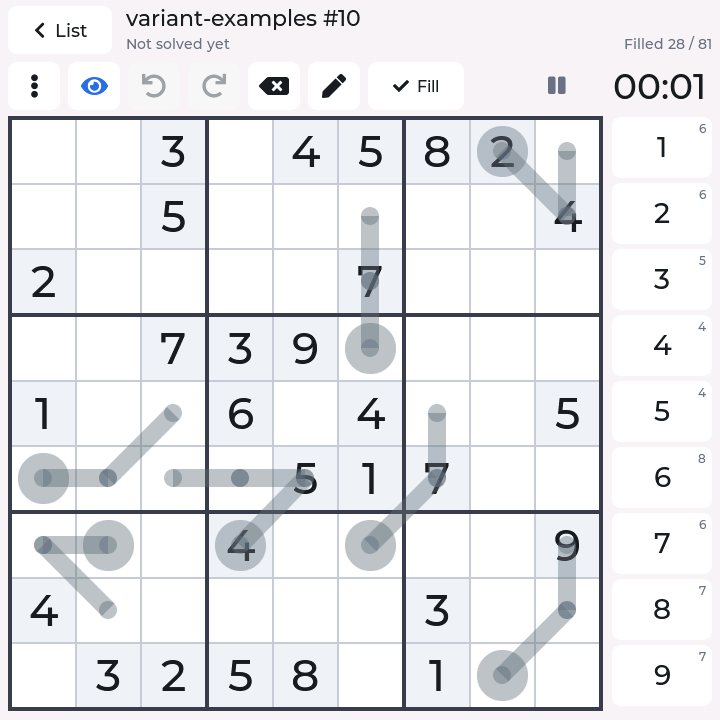

## The rules

[Classic](classic.md) rules, plus **thermometers**: grey lines with a round **bulb** at one end, through cells side by side or diagonal. Along each one, the digits **rise** from the bulb: every digit is bigger than the one before it (not necessarily by 1).

## On the board

- Each thermometer is a wide, translucent grey line with a round bulb; the digits show through.
- Two digits along one that don't rise turn red.
- The grader and hints narrow each thermometer cell from both ends: "Along the thermometer the digits rise from the bulb, so row 2, column 5 can only be 4, 5".
- **Puzzles → ⋮ → New puzzle → Thermo**: 7 thermometers of 3 to 6 cells (Hard and Expert up to 10).

## How to solve it

- **Count from the ends:** on a thermometer of 5 cells, the bulb is at most 5 and the tip at least 5; the k-th cell is at least k and at most 9 − (length − k).
- **Around a given:** cells before a given digit are smaller than it, cells after it bigger. A bulb before a 2 must be 1.
- Combine with the Classic rules: a thermometer often leaves a cell two or three options, and the row or box picks one, as in the worked example.

## Worked example

**variant-examples #10**, Thermo Easy (see [Classic](classic.md#worked-example-the-whole-puzzle) for how to import the examples; cells are written r*row*c*column*). The thermometers are in the screenshot; two matter here, both through a 7:

- bulb **r4c6**, then r3c6 (a 7), then r2c6, going up;
- bulb **r7c6**, then r6c7 (a 7), then r5c7, going diagonally up and right.

**Step 1: r4c6, a bulb below a 7.** Row 4 has 7, 3 and 9; column 6 has 5, 7, 4 and 1; box 5 has 3, 9, 6, 4, 5 and 1. By the Classic rules r4c6 could be 2 or 8. It's the bulb of the thermometer through the 7 at r3c6, so it's smaller than 7. **r4c6 = 2**.

**Step 2: r5c7, the tip after a 7.** Row 5 has 1, 6, 4 and 5; column 7 has 8, 7, 3 and 1. That leaves 2 and 9. r5c7 comes after the 7 (r6c7) on its thermometer, so it's bigger than 7. **r5c7 = 9**.

**Step 3: the 3 in column 6.** Column 6 is now filled except for r2c6, r7c6, r8c6 and r9c6:

- r2c6: it comes after the 7 (r3c6) on the first thermometer, so it's 8 or 9, not 3.
- r8c6: row 8 has a 3 (r8c7).
- r9c6: row 9 has a 3 (r9c2).

Only **r7c6** is left: **r7c6 = 3**. It's the bulb of the second thermometer, and 3 is below its 7, as it should be.

## The whole puzzle, step by step

<!-- walkthrough -->
<!-- Written by tools/walkthrough.py thermo: edit the script, not this part. -->

The whole puzzle, from the start to the last cell: 53 steps, each one a single (one place left for a digit, or one digit left for a cell), taken in the order a box's single comes first, so not quite the order of the worked example above. In each picture, the unit the step looks at is tinted yellow (for a cell with one digit left: its row, column and box), the new digit is on green, the digits that rule cells out have an **orange ring**, and the empty cells they rule out a **red cross**. Givens are on grey, digits from earlier steps in blue.

#### Step 1: the 3 in box 4

Box 4 needs a 3. r4c1 and r4c2: row 4 has one (r4c4). r5c2 and r6c2: column 2 has one (r9c2). r5c3 and r6c3: column 3 has one (r1c3). Only **r6c1** is left: **r6c1 = 3**.

#### Step 2: the 7 in box 5

Box 5 needs a 7. r4c6: row 4 has one (r4c3). r6c4: row 6 has one (r6c7). Only **r5c5** is left: **r5c5 = 7**.

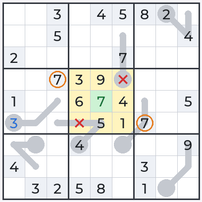

#### Step 3: the 2 in box 5

Box 5 needs a 2. r6c4: its place on its thermometer keeps it between 3 and 8. Only **r4c6** is left: **r4c6 = 2**.

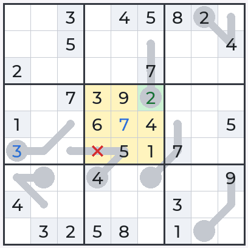

#### Step 4: the 2 in box 4

Box 4 needs a 2. r4c1 and r4c2: row 4 has one (r4c6). r5c3 and r6c3: column 3 has one (r9c3). r6c2: it comes after the 3 in r6c1 on its thermometer, so it's above 3. Only **r5c2** is left: **r5c2 = 2**.

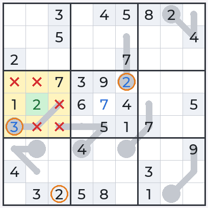

#### Step 5: the 8 in box 5

Box 5 needs an 8, and r6c4 is its last empty cell: **r6c4 = 8**.

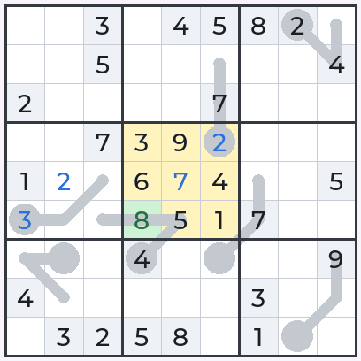

#### Step 6: the 8 in box 2

Box 2 needs an 8. r1c4: row 1 has one (r1c7). r2c4 and r3c4: column 4 has one (r6c4). r2c5 and r3c5: column 5 has one (r9c5). Only **r2c6** is left: **r2c6 = 8**.

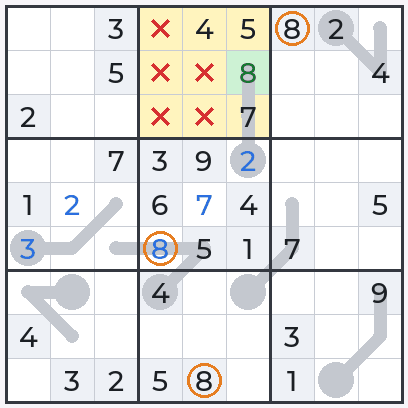

#### Step 7: the 2 in box 6

Box 6 needs a 2. r4c7, r4c8 and r4c9: row 4 has one (r4c6). r5c7 and r5c8: row 5 has one (r5c2). r6c8: column 8 has one (r1c8). Only **r6c9** is left: **r6c9 = 2**.

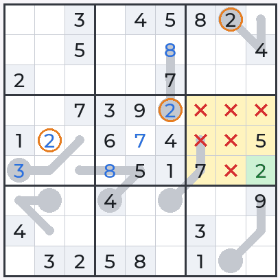

#### Step 8: the 3 in box 6

Box 6 needs a 3. r4c7, r4c8 and r4c9: row 4 has one (r4c4). r5c7: column 7 has one (r8c7). r6c8: row 6 has one (r6c1). Only **r5c8** is left: **r5c8 = 3**.

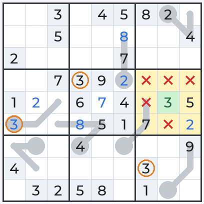

#### Step 9: the 3 in box 3

Box 3 needs a 3. r1c9: row 1 has one (r1c3). r2c7 and r3c7: column 7 has one (r8c7). r2c8 and r3c8: column 8 has one (r5c8). Only **r3c9** is left: **r3c9 = 3**.

#### Step 10: the 3 in box 2

Box 2 needs a 3. r1c4: row 1 has one (r1c3). r2c4: column 4 has one (r4c4). r3c4 and r3c5: row 3 has one (r3c9). Only **r2c5** is left: **r2c5 = 3**.

#### Step 11: the 2 in box 2

Box 2 needs a 2. r1c4: row 1 has one (r1c8). r3c4 and r3c5: row 3 has one (r3c1). Only **r2c4** is left: **r2c4 = 2**.

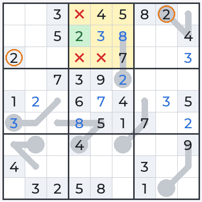

#### Step 12: the 6 in box 2

Box 2 needs a 6. r1c4 and r3c4: column 4 has one (r5c4). Only **r3c5** is left: **r3c5 = 6**.

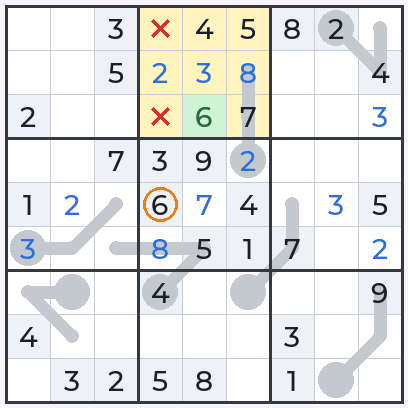

#### Step 13: the 3 in box 8

Box 8 needs a 3. r7c5: column 5 has one (r2c5). r8c4, r8c5 and r8c6: row 8 has one (r8c7). r9c6: row 9 has one (r9c2). Only **r7c6** is left: **r7c6 = 3**.

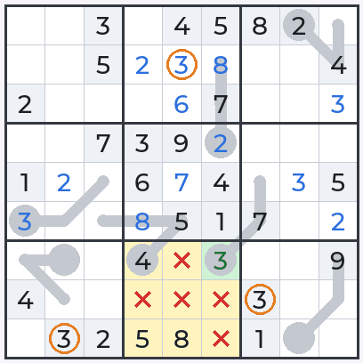

#### Step 14: the 7 in box 8

Box 8 needs a 7. r7c5 and r8c5: column 5 has one (r5c5). r8c6 and r9c6: column 6 has one (r3c6). Only **r8c4** is left: **r8c4 = 7**.

#### Step 15: the 2 in box 9

Box 9 needs a 2. r7c8 and r8c8: column 8 has one (r1c8). r8c9: column 9 has one (r6c9). r9c8 and r9c9: row 9 has one (r9c3). Only **r7c7** is left: **r7c7 = 2**.

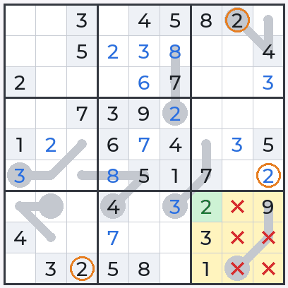

#### Step 16: the 2 in box 8

Box 8 needs a 2. r7c5: row 7 has one (r7c7). r8c6: column 6 has one (r4c6). r9c6: row 9 has one (r9c3). Only **r8c5** is left: **r8c5 = 2**.

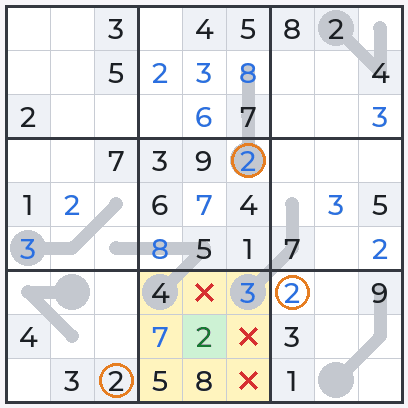

#### Step 17: the 1 in box 8

Box 8 needs a 1. r8c6: column 6 has one (r6c6). r9c6: row 9 has one (r9c7). Only **r7c5** is left: **r7c5 = 1**.

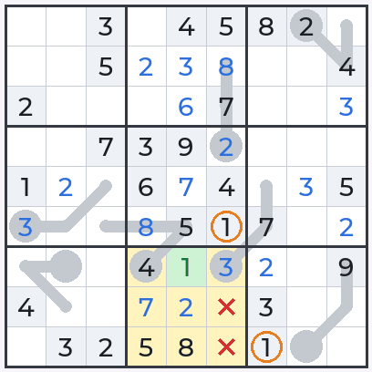

#### Step 18: the 1 in box 7

Box 7 needs a 1. r7c1, r7c2 and r7c3: row 7 has one (r7c5). r9c1: row 9 has one (r9c7). r8c2: its place on its thermometer keeps it between 3 and 9. Only **r8c3** is left: **r8c3 = 1**.

#### Step 19: the 4 in box 9

Box 9 needs a 4. r7c8: row 7 has one (r7c4). r8c8 and r8c9: row 8 has one (r8c1). r9c9: column 9 has one (r2c9). Only **r9c8** is left: **r9c8 = 4**.

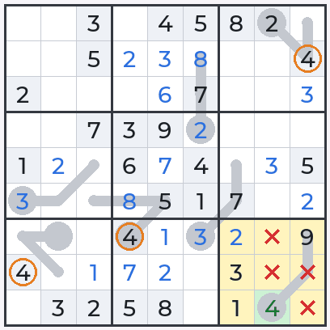

#### Step 20: the 4 in box 6

Box 6 needs a 4. r4c8 and r6c8: column 8 has one (r9c8). r4c9: column 9 has one (r2c9). r5c7: row 5 has one (r5c6). Only **r4c7** is left: **r4c7 = 4**.

#### Step 21: the 4 in box 4

Box 4 needs a 4. r4c1 and r4c2: row 4 has one (r4c7). r5c3: row 5 has one (r5c6). r6c3: it comes after the 8 in r6c4 on its thermometer, so it's above 8. Only **r6c2** is left: **r6c2 = 4**.

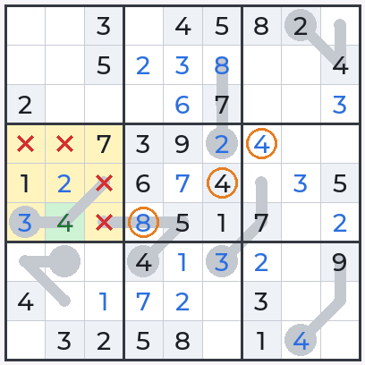

#### Step 22: the 4 in box 1

Box 1 needs a 4. r1c1 and r1c2: row 1 has one (r1c5). r2c1 and r2c2: row 2 has one (r2c9). r3c2: column 2 has one (r6c2). Only **r3c3** is left: **r3c3 = 4**.

#### Step 23: the 8 in box 1

Box 1 needs an 8. r1c1 and r1c2: row 1 has one (r1c7). r2c1 and r2c2: row 2 has one (r2c6). Only **r3c2** is left: **r3c2 = 8**.

#### Step 24: the 8 in row 5

Row 5 needs an 8. r5c7: column 7 has one (r1c7). Only **r5c3** is left: **r5c3 = 8**.

#### Step 25: the 9 in box 4

Box 4 needs a 9. r4c1 and r4c2: row 4 has one (r4c5). Only **r6c3** is left: **r6c3 = 9**.

#### Step 26: the 9 in box 6

Box 6 needs a 9. r4c8 and r4c9: row 4 has one (r4c5). r6c8: row 6 has one (r6c3). Only **r5c7** is left: **r5c7 = 9**.

#### Step 27: the 8 in box 7

Box 7 needs an 8. r7c2 and r8c2: column 2 has one (r3c2). r7c3: column 3 has one (r5c3). r9c1: row 9 has one (r9c5). Only **r7c1** is left: **r7c1 = 8**.

#### Step 28: the 5 in box 7

Box 7 needs a 5. r7c3: column 3 has one (r2c3). r9c1: row 9 has one (r9c4). r8c2: it comes after the 8 in r7c1 on its thermometer, so it's above 8. Only **r7c2** is left: **r7c2 = 5**.

#### Step 29: the 5 in box 4

Box 4 needs a 5. r4c2: column 2 has one (r7c2). Only **r4c1** is left: **r4c1 = 5**.

#### Step 30: the 6 in box 4

Box 4 needs a 6, and r4c2 is its last empty cell: **r4c2 = 6**.

#### Step 31: the 6 in box 6

Box 6 needs a 6. r4c8 and r4c9: row 4 has one (r4c2). Only **r6c8** is left: **r6c8 = 6**.

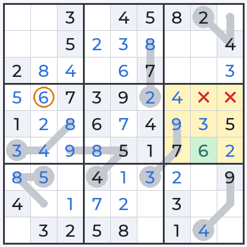

#### Step 32: the 7 in box 7

Box 7 needs a 7. r7c3: column 3 has one (r4c3). r8c2: row 8 has one (r8c4). Only **r9c1** is left: **r9c1 = 7**.

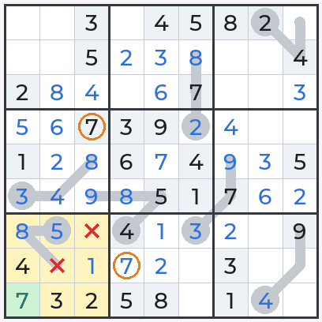

#### Step 33: the 6 in box 7

Box 7 needs a 6. r8c2: column 2 has one (r4c2). Only **r7c3** is left: **r7c3 = 6**.

#### Step 34: the 9 in box 7

Box 7 needs a 9, and r8c2 is its last empty cell: **r8c2 = 9**.

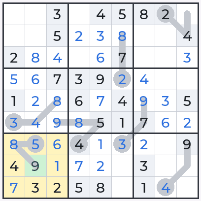

#### Step 35: the 9 in box 8

Box 8 needs a 9. r8c6: row 8 has one (r8c2). Only **r9c6** is left: **r9c6 = 9**.

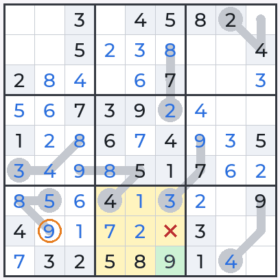

#### Step 36: the 6 in box 8

Box 8 needs a 6, and r8c6 is its last empty cell: **r8c6 = 6**.

#### Step 37: the 5 in box 9

Box 9 needs a 5. r7c8: row 7 has one (r7c2). r8c9: column 9 has one (r5c9). r9c9: row 9 has one (r9c4). Only **r8c8** is left: **r8c8 = 5**.

#### Step 38: the 5 in box 3

Box 3 needs a 5. r1c9: row 1 has one (r1c6). r2c7 and r2c8: row 2 has one (r2c3). r3c8: column 8 has one (r8c8). Only **r3c7** is left: **r3c7 = 5**.

#### Step 39: the 6 in box 9

Box 9 needs a 6. r7c8: row 7 has one (r7c3). r8c9: row 8 has one (r8c6). Only **r9c9** is left: **r9c9 = 6**.

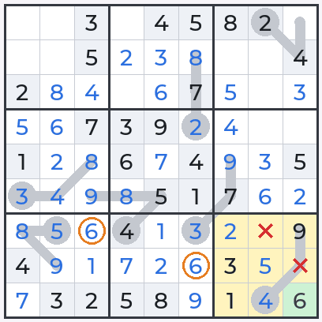

#### Step 40: the 6 in box 3

Box 3 needs a 6. r1c9: column 9 has one (r9c9). r2c8: column 8 has one (r6c8). r3c8: row 3 has one (r3c5). Only **r2c7** is left: **r2c7 = 6**.

#### Step 41: the 6 in box 1

Box 1 needs a 6. r1c2: column 2 has one (r4c2). r2c1 and r2c2: row 2 has one (r2c7). Only **r1c1** is left: **r1c1 = 6**.

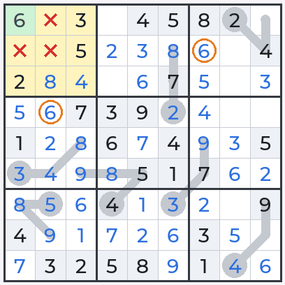

#### Step 42: the 9 in box 1

Box 1 needs a 9. r1c2 and r2c2: column 2 has one (r8c2). Only **r2c1** is left: **r2c1 = 9**.

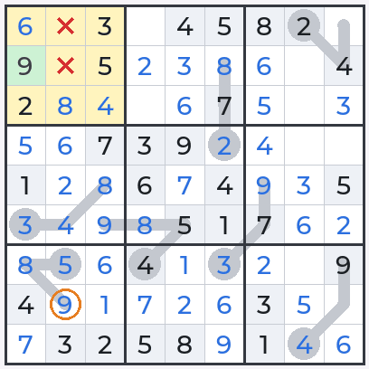

#### Step 43: the 9 in box 3

Box 3 needs a 9. r1c9: column 9 has one (r7c9). r2c8: row 2 has one (r2c1). Only **r3c8** is left: **r3c8 = 9**.

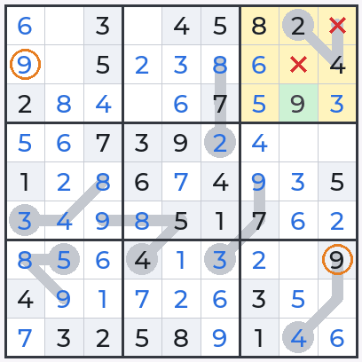

#### Step 44: the 9 in box 2

Box 2 needs a 9. r3c4: row 3 has one (r3c8). Only **r1c4** is left: **r1c4 = 9**.

#### Step 45: the 1 in box 2

Box 2 needs a 1, and r3c4 is its last empty cell: **r3c4 = 1**.

#### Step 46: the 1 in box 3

Box 3 needs a 1. r1c9: its place on its thermometer keeps it between 3 and 9. Only **r2c8** is left: **r2c8 = 1**.

#### Step 47: the 1 in box 1

Box 1 needs a 1. r2c2: row 2 has one (r2c8). Only **r1c2** is left: **r1c2 = 1**.

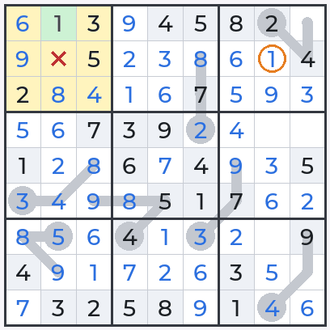

#### Step 48: the 7 in box 1

Box 1 needs a 7, and r2c2 is its last empty cell: **r2c2 = 7**.

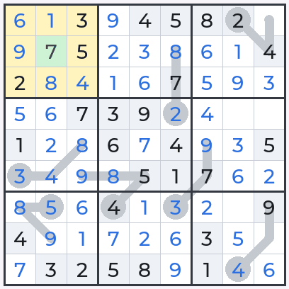

#### Step 49: the 7 in box 3

Box 3 needs a 7, and r1c9 is its last empty cell: **r1c9 = 7**.

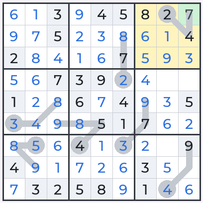

#### Step 50: the 1 in box 6

Box 6 needs a 1. r4c8: column 8 has one (r2c8). Only **r4c9** is left: **r4c9 = 1**.

#### Step 51: the 8 in box 6

Box 6 needs an 8, and r4c8 is its last empty cell: **r4c8 = 8**.

#### Step 52: the 7 in box 9

Box 9 needs a 7. r8c9: row 8 has one (r8c4). Only **r7c8** is left: **r7c8 = 7**.

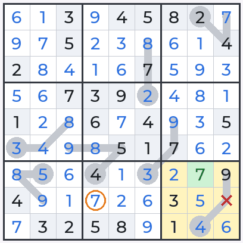

#### Step 53: the 8 in box 9

Box 9 needs an 8, and r8c9 is its last empty cell: **r8c9 = 8**.

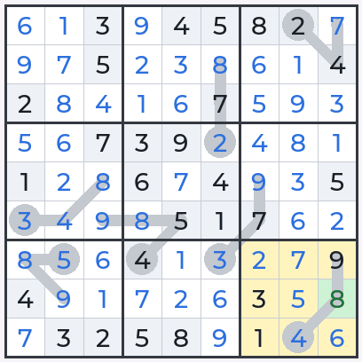

Solved.

<!-- /walkthrough -->
