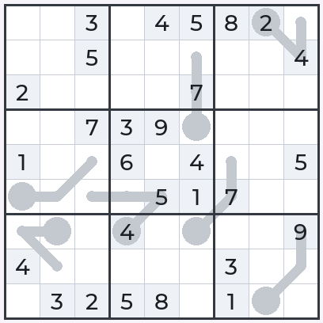

# Thermo

[← All variants](README.md) · [Puzzles](../features-puzzles.md) · [How to play](../how-to-play.md)

## The rules

[Classic](classic.md) rules, plus **thermometers**: grey lines with a round **bulb** at one end, through cells side by side or diagonal. Along each one, the digits **rise** from the bulb: every digit is bigger than the one before it (not necessarily by 1).

## On the board

- Each thermometer is a wide, translucent grey line with a round bulb; the digits show through.
- Two digits along one that don't rise turn red.
- The grader and hints narrow each thermometer cell from both ends: "Along the thermometer the digits rise from the bulb, so row 2, column 5 can only be 4, 5".
- **Puzzles → ⋮ → New puzzle → Thermo**: 7 thermometers of 3 to 6 cells (Hard and Expert up to 10).

## How to solve it

- **Count from the ends:** on a thermometer of 5 cells, the bulb is at most 5 and the tip at least 5; the k-th cell is at least k and at most 9 − (length − k).
- **Around a given:** cells before a given digit are smaller than it, cells after it bigger. A bulb before a 2 must be 1.
- Combine with the Classic rules: a thermometer often leaves a cell two or three options, and the row or box picks one, as in the worked example.

## Worked example

**variant-examples #10**, Thermo Easy (see [Classic](classic.md#worked-example-the-whole-puzzle) for how to import the examples; cells are written r*row*c*column*). The thermometers are in the screenshot; two matter here, both through a 7:

- bulb **r4c6**, then r3c6 (a 7), then r2c6, going up;
- bulb **r7c6**, then r6c7 (a 7), then r5c7, going diagonally up and right.

**Step 1: r4c6, a bulb below a 7.** Row 4 has 7, 3 and 9; column 6 has 5, 7, 4 and 1; box 5 has 3, 9, 6, 4, 5 and 1. By the Classic rules r4c6 could be 2 or 8. It's the bulb of the thermometer through the 7 at r3c6, so it's smaller than 7. **r4c6 = 2**.

**Step 2: r5c7, the tip after a 7.** Row 5 has 1, 6, 4 and 5; column 7 has 8, 7, 3 and 1. That leaves 2 and 9. r5c7 comes after the 7 (r6c7) on its thermometer, so it's bigger than 7. **r5c7 = 9**.

**Step 3: the 3 in column 6.** Column 6 is now filled except for r2c6, r7c6, r8c6 and r9c6:

- r2c6: it comes after the 7 (r3c6) on the first thermometer, so it's 8 or 9, not 3.
- r8c6: row 8 has a 3 (r8c7).
- r9c6: row 9 has a 3 (r9c2).

Only **r7c6** is left: **r7c6 = 3**. It's the bulb of the second thermometer, and 3 is below its 7, as it should be.

## The whole puzzle, step by step

<!-- walkthrough -->
<!-- Written by tools/walkthrough.py thermo: edit the script, not this part. -->

The whole puzzle, from the start to the last cell: 53 steps, each one a single (one place left for a digit, or one digit left for a cell), taken in the order a box's single comes first, so not quite the order of the worked example above. Each step has a page of its own, with **Previous** and **Next**: pick its number below. In each picture, the unit the step looks at is tinted yellow (for a cell with one digit left: its row, column and box), the new digit is on green, the digits that rule cells out have an **orange ring**, and the empty cells they rule out a **red cross**. Givens are on grey, digits from earlier steps in blue.

| [1](thermo/step-01.md) | [2](thermo/step-02.md) | [3](thermo/step-03.md) | [4](thermo/step-04.md) | [5](thermo/step-05.md) | [6](thermo/step-06.md) | [7](thermo/step-07.md) | [8](thermo/step-08.md) | [9](thermo/step-09.md) | [10](thermo/step-10.md) |
|:-:|:-:|:-:|:-:|:-:|:-:|:-:|:-:|:-:|:-:|
| [11](thermo/step-11.md) | [12](thermo/step-12.md) | [13](thermo/step-13.md) | [14](thermo/step-14.md) | [15](thermo/step-15.md) | [16](thermo/step-16.md) | [17](thermo/step-17.md) | [18](thermo/step-18.md) | [19](thermo/step-19.md) | [20](thermo/step-20.md) |
| [21](thermo/step-21.md) | [22](thermo/step-22.md) | [23](thermo/step-23.md) | [24](thermo/step-24.md) | [25](thermo/step-25.md) | [26](thermo/step-26.md) | [27](thermo/step-27.md) | [28](thermo/step-28.md) | [29](thermo/step-29.md) | [30](thermo/step-30.md) |
| [31](thermo/step-31.md) | [32](thermo/step-32.md) | [33](thermo/step-33.md) | [34](thermo/step-34.md) | [35](thermo/step-35.md) | [36](thermo/step-36.md) | [37](thermo/step-37.md) | [38](thermo/step-38.md) | [39](thermo/step-39.md) | [40](thermo/step-40.md) |
| [41](thermo/step-41.md) | [42](thermo/step-42.md) | [43](thermo/step-43.md) | [44](thermo/step-44.md) | [45](thermo/step-45.md) | [46](thermo/step-46.md) | [47](thermo/step-47.md) | [48](thermo/step-48.md) | [49](thermo/step-49.md) | [50](thermo/step-50.md) |
| [51](thermo/step-51.md) | [52](thermo/step-52.md) | [53](thermo/step-53.md) |  |  |  |  |  |  |  |

Solved.

<!-- /walkthrough -->
