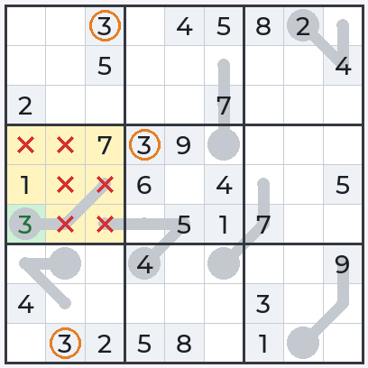

<!-- Written by tools/walkthrough.py thermo: edit the script, not this page. -->
# Thermo, step 1: the 3 in box 4

**Step 1 of 53** · [← The start](../thermo.md#the-whole-puzzle-step-by-step) · [All steps](../thermo.md#the-whole-puzzle-step-by-step) · [Step 2 →](step-02.md)

Box 4 needs a 3. r4c1 and r4c2: row 4 has one (r4c4). r5c2 and r6c2: column 2 has one (r9c2). r5c3 and r6c3: column 3 has one (r1c3). Only **r6c1** is left: **r6c1 = 3**.

**Step 1 of 53** · [← The start](../thermo.md#the-whole-puzzle-step-by-step) · [All steps](../thermo.md#the-whole-puzzle-step-by-step) · [Step 2 →](step-02.md)
