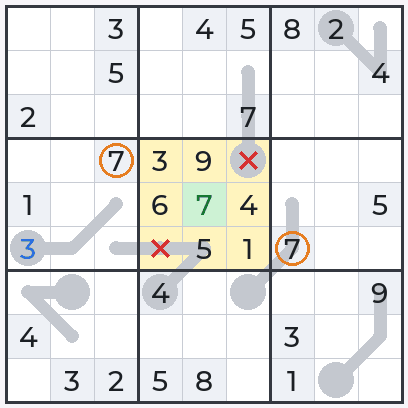

<!-- Written by tools/walkthrough.py thermo: edit the script, not this page. -->
# Thermo, step 2: the 7 in box 5

**Step 2 of 53** · [← Step 1](step-01.md) · [All steps](../thermo.md#the-whole-puzzle-step-by-step) · [Step 3 →](step-03.md)

Box 5 needs a 7. r4c6: row 4 has one (r4c3). r6c4: row 6 has one (r6c7). Only **r5c5** is left: **r5c5 = 7**.

**Step 2 of 53** · [← Step 1](step-01.md) · [All steps](../thermo.md#the-whole-puzzle-step-by-step) · [Step 3 →](step-03.md)
