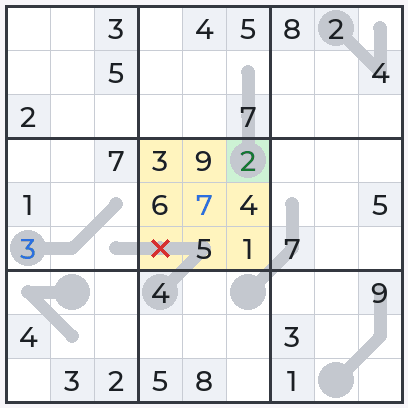

<!-- Written by tools/walkthrough.py thermo: edit the script, not this page. -->
# Thermo, step 3: the 2 in box 5

**Step 3 of 53** · [← Step 2](step-02.md) · [All steps](../thermo.md#the-whole-puzzle-step-by-step) · [Step 4 →](step-04.md)

Box 5 needs a 2. r6c4: its place on its thermometer keeps it between 3 and 8. Only **r4c6** is left: **r4c6 = 2**.

**Step 3 of 53** · [← Step 2](step-02.md) · [All steps](../thermo.md#the-whole-puzzle-step-by-step) · [Step 4 →](step-04.md)
