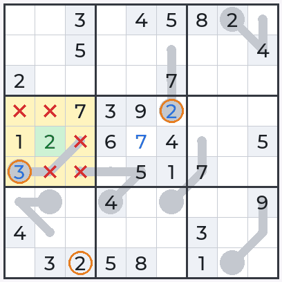

<!-- Written by tools/walkthrough.py thermo: edit the script, not this page. -->
# Thermo, step 4: the 2 in box 4

**Step 4 of 53** · [← Step 3](step-03.md) · [All steps](../thermo.md#the-whole-puzzle-step-by-step) · [Step 5 →](step-05.md)

Box 4 needs a 2. r4c1 and r4c2: row 4 has one (r4c6). r5c3 and r6c3: column 3 has one (r9c3). r6c2: it comes after the 3 in r6c1 on its thermometer, so it's above 3. Only **r5c2** is left: **r5c2 = 2**.

**Step 4 of 53** · [← Step 3](step-03.md) · [All steps](../thermo.md#the-whole-puzzle-step-by-step) · [Step 5 →](step-05.md)
