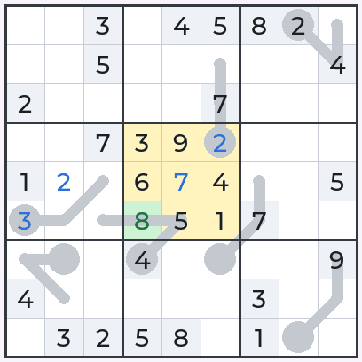

<!-- Written by tools/walkthrough.py thermo: edit the script, not this page. -->
# Thermo, step 5: the 8 in box 5

**Step 5 of 53** · [← Step 4](step-04.md) · [All steps](../thermo.md#the-whole-puzzle-step-by-step) · [Step 6 →](step-06.md)

Box 5 needs an 8, and r6c4 is its last empty cell: **r6c4 = 8**.

**Step 5 of 53** · [← Step 4](step-04.md) · [All steps](../thermo.md#the-whole-puzzle-step-by-step) · [Step 6 →](step-06.md)
