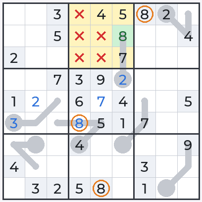

<!-- Written by tools/walkthrough.py thermo: edit the script, not this page. -->
# Thermo, step 6: the 8 in box 2

**Step 6 of 53** · [← Step 5](step-05.md) · [All steps](../thermo.md#the-whole-puzzle-step-by-step) · [Step 7 →](step-07.md)

Box 2 needs an 8. r1c4: row 1 has one (r1c7). r2c4 and r3c4: column 4 has one (r6c4). r2c5 and r3c5: column 5 has one (r9c5). Only **r2c6** is left: **r2c6 = 8**.

**Step 6 of 53** · [← Step 5](step-05.md) · [All steps](../thermo.md#the-whole-puzzle-step-by-step) · [Step 7 →](step-07.md)
