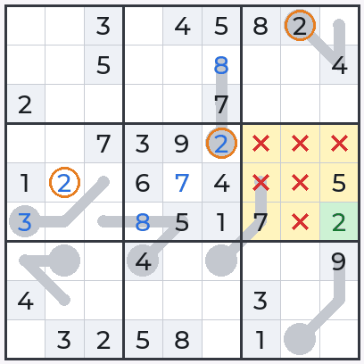

<!-- Written by tools/walkthrough.py thermo: edit the script, not this page. -->
# Thermo, step 7: the 2 in box 6

**Step 7 of 53** · [← Step 6](step-06.md) · [All steps](../thermo.md#the-whole-puzzle-step-by-step) · [Step 8 →](step-08.md)

Box 6 needs a 2. r4c7, r4c8 and r4c9: row 4 has one (r4c6). r5c7 and r5c8: row 5 has one (r5c2). r6c8: column 8 has one (r1c8). Only **r6c9** is left: **r6c9 = 2**.

**Step 7 of 53** · [← Step 6](step-06.md) · [All steps](../thermo.md#the-whole-puzzle-step-by-step) · [Step 8 →](step-08.md)
