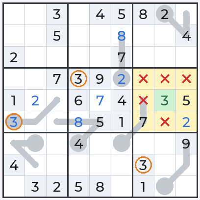

<!-- Written by tools/walkthrough.py thermo: edit the script, not this page. -->
# Thermo, step 8: the 3 in box 6

**Step 8 of 53** · [← Step 7](step-07.md) · [All steps](../thermo.md#the-whole-puzzle-step-by-step) · [Step 9 →](step-09.md)

Box 6 needs a 3. r4c7, r4c8 and r4c9: row 4 has one (r4c4). r5c7: column 7 has one (r8c7). r6c8: row 6 has one (r6c1). Only **r5c8** is left: **r5c8 = 3**.

**Step 8 of 53** · [← Step 7](step-07.md) · [All steps](../thermo.md#the-whole-puzzle-step-by-step) · [Step 9 →](step-09.md)
