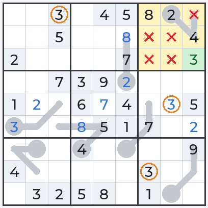

<!-- Written by tools/walkthrough.py thermo: edit the script, not this page. -->
# Thermo, step 9: the 3 in box 3

**Step 9 of 53** · [← Step 8](step-08.md) · [All steps](../thermo.md#the-whole-puzzle-step-by-step) · [Step 10 →](step-10.md)

Box 3 needs a 3. r1c9: row 1 has one (r1c3). r2c7 and r3c7: column 7 has one (r8c7). r2c8 and r3c8: column 8 has one (r5c8). Only **r3c9** is left: **r3c9 = 3**.

**Step 9 of 53** · [← Step 8](step-08.md) · [All steps](../thermo.md#the-whole-puzzle-step-by-step) · [Step 10 →](step-10.md)
