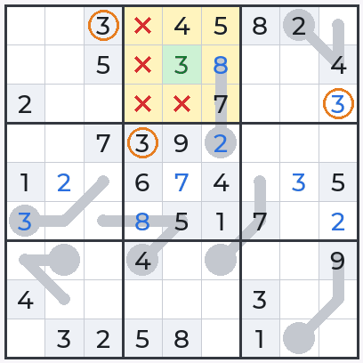

<!-- Written by tools/walkthrough.py thermo: edit the script, not this page. -->
# Thermo, step 10: the 3 in box 2

**Step 10 of 53** · [← Step 9](step-09.md) · [All steps](../thermo.md#the-whole-puzzle-step-by-step) · [Step 11 →](step-11.md)

Box 2 needs a 3. r1c4: row 1 has one (r1c3). r2c4: column 4 has one (r4c4). r3c4 and r3c5: row 3 has one (r3c9). Only **r2c5** is left: **r2c5 = 3**.

**Step 10 of 53** · [← Step 9](step-09.md) · [All steps](../thermo.md#the-whole-puzzle-step-by-step) · [Step 11 →](step-11.md)
