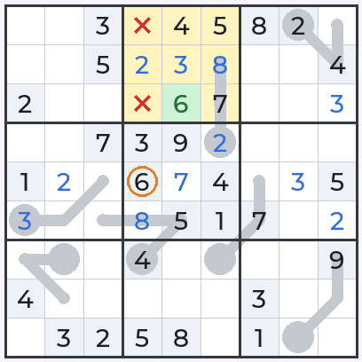

<!-- Written by tools/walkthrough.py thermo: edit the script, not this page. -->
# Thermo, step 12: the 6 in box 2

**Step 12 of 53** · [← Step 11](step-11.md) · [All steps](../thermo.md#the-whole-puzzle-step-by-step) · [Step 13 →](step-13.md)

Box 2 needs a 6. r1c4 and r3c4: column 4 has one (r5c4). Only **r3c5** is left: **r3c5 = 6**.

**Step 12 of 53** · [← Step 11](step-11.md) · [All steps](../thermo.md#the-whole-puzzle-step-by-step) · [Step 13 →](step-13.md)
