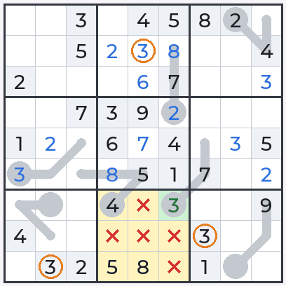

<!-- Written by tools/walkthrough.py thermo: edit the script, not this page. -->
# Thermo, step 13: the 3 in box 8

**Step 13 of 53** · [← Step 12](step-12.md) · [All steps](../thermo.md#the-whole-puzzle-step-by-step) · [Step 14 →](step-14.md)

Box 8 needs a 3. r7c5: column 5 has one (r2c5). r8c4, r8c5 and r8c6: row 8 has one (r8c7). r9c6: row 9 has one (r9c2). Only **r7c6** is left: **r7c6 = 3**.

**Step 13 of 53** · [← Step 12](step-12.md) · [All steps](../thermo.md#the-whole-puzzle-step-by-step) · [Step 14 →](step-14.md)
