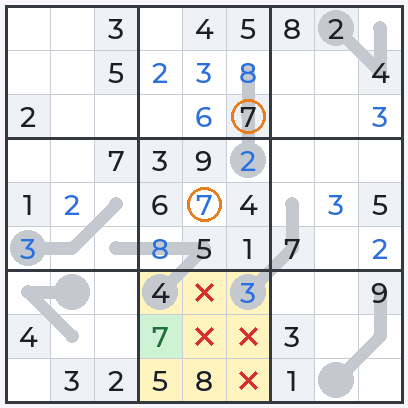

<!-- Written by tools/walkthrough.py thermo: edit the script, not this page. -->
# Thermo, step 14: the 7 in box 8

**Step 14 of 53** · [← Step 13](step-13.md) · [All steps](../thermo.md#the-whole-puzzle-step-by-step) · [Step 15 →](step-15.md)

Box 8 needs a 7. r7c5 and r8c5: column 5 has one (r5c5). r8c6 and r9c6: column 6 has one (r3c6). Only **r8c4** is left: **r8c4 = 7**.

**Step 14 of 53** · [← Step 13](step-13.md) · [All steps](../thermo.md#the-whole-puzzle-step-by-step) · [Step 15 →](step-15.md)
