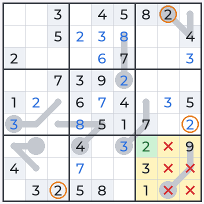

<!-- Written by tools/walkthrough.py thermo: edit the script, not this page. -->
# Thermo, step 15: the 2 in box 9

**Step 15 of 53** · [← Step 14](step-14.md) · [All steps](../thermo.md#the-whole-puzzle-step-by-step) · [Step 16 →](step-16.md)

Box 9 needs a 2. r7c8 and r8c8: column 8 has one (r1c8). r8c9: column 9 has one (r6c9). r9c8 and r9c9: row 9 has one (r9c3). Only **r7c7** is left: **r7c7 = 2**.

**Step 15 of 53** · [← Step 14](step-14.md) · [All steps](../thermo.md#the-whole-puzzle-step-by-step) · [Step 16 →](step-16.md)
