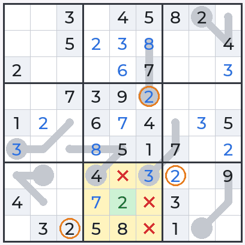

<!-- Written by tools/walkthrough.py thermo: edit the script, not this page. -->
# Thermo, step 16: the 2 in box 8

**Step 16 of 53** · [← Step 15](step-15.md) · [All steps](../thermo.md#the-whole-puzzle-step-by-step) · [Step 17 →](step-17.md)

Box 8 needs a 2. r7c5: row 7 has one (r7c7). r8c6: column 6 has one (r4c6). r9c6: row 9 has one (r9c3). Only **r8c5** is left: **r8c5 = 2**.

**Step 16 of 53** · [← Step 15](step-15.md) · [All steps](../thermo.md#the-whole-puzzle-step-by-step) · [Step 17 →](step-17.md)
