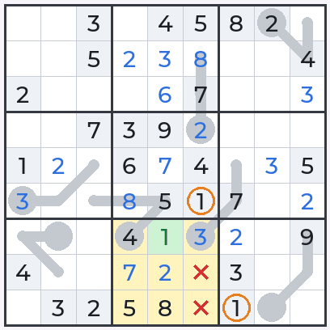

<!-- Written by tools/walkthrough.py thermo: edit the script, not this page. -->
# Thermo, step 17: the 1 in box 8

**Step 17 of 53** · [← Step 16](step-16.md) · [All steps](../thermo.md#the-whole-puzzle-step-by-step) · [Step 18 →](step-18.md)

Box 8 needs a 1. r8c6: column 6 has one (r6c6). r9c6: row 9 has one (r9c7). Only **r7c5** is left: **r7c5 = 1**.

**Step 17 of 53** · [← Step 16](step-16.md) · [All steps](../thermo.md#the-whole-puzzle-step-by-step) · [Step 18 →](step-18.md)
