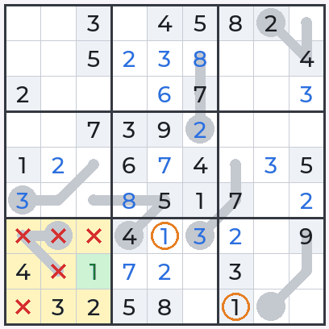

<!-- Written by tools/walkthrough.py thermo: edit the script, not this page. -->
# Thermo, step 18: the 1 in box 7

**Step 18 of 53** · [← Step 17](step-17.md) · [All steps](../thermo.md#the-whole-puzzle-step-by-step) · [Step 19 →](step-19.md)

Box 7 needs a 1. r7c1, r7c2 and r7c3: row 7 has one (r7c5). r9c1: row 9 has one (r9c7). r8c2: its place on its thermometer keeps it between 3 and 9. Only **r8c3** is left: **r8c3 = 1**.

**Step 18 of 53** · [← Step 17](step-17.md) · [All steps](../thermo.md#the-whole-puzzle-step-by-step) · [Step 19 →](step-19.md)
