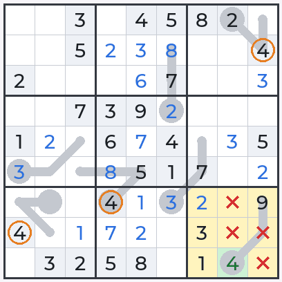

<!-- Written by tools/walkthrough.py thermo: edit the script, not this page. -->
# Thermo, step 19: the 4 in box 9

**Step 19 of 53** · [← Step 18](step-18.md) · [All steps](../thermo.md#the-whole-puzzle-step-by-step) · [Step 20 →](step-20.md)

Box 9 needs a 4. r7c8: row 7 has one (r7c4). r8c8 and r8c9: row 8 has one (r8c1). r9c9: column 9 has one (r2c9). Only **r9c8** is left: **r9c8 = 4**.

**Step 19 of 53** · [← Step 18](step-18.md) · [All steps](../thermo.md#the-whole-puzzle-step-by-step) · [Step 20 →](step-20.md)
