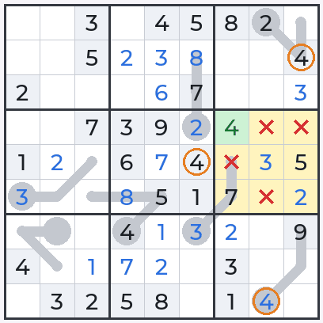

<!-- Written by tools/walkthrough.py thermo: edit the script, not this page. -->
# Thermo, step 20: the 4 in box 6

**Step 20 of 53** · [← Step 19](step-19.md) · [All steps](../thermo.md#the-whole-puzzle-step-by-step) · [Step 21 →](step-21.md)

Box 6 needs a 4. r4c8 and r6c8: column 8 has one (r9c8). r4c9: column 9 has one (r2c9). r5c7: row 5 has one (r5c6). Only **r4c7** is left: **r4c7 = 4**.

**Step 20 of 53** · [← Step 19](step-19.md) · [All steps](../thermo.md#the-whole-puzzle-step-by-step) · [Step 21 →](step-21.md)
