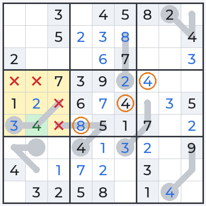

<!-- Written by tools/walkthrough.py thermo: edit the script, not this page. -->
# Thermo, step 21: the 4 in box 4

**Step 21 of 53** · [← Step 20](step-20.md) · [All steps](../thermo.md#the-whole-puzzle-step-by-step) · [Step 22 →](step-22.md)

Box 4 needs a 4. r4c1 and r4c2: row 4 has one (r4c7). r5c3: row 5 has one (r5c6). r6c3: it comes after the 8 in r6c4 on its thermometer, so it's above 8. Only **r6c2** is left: **r6c2 = 4**.

**Step 21 of 53** · [← Step 20](step-20.md) · [All steps](../thermo.md#the-whole-puzzle-step-by-step) · [Step 22 →](step-22.md)
