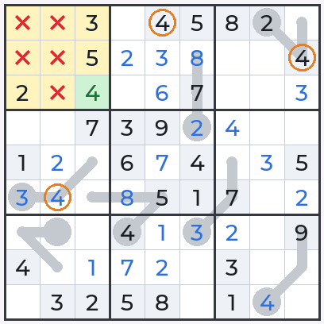

<!-- Written by tools/walkthrough.py thermo: edit the script, not this page. -->
# Thermo, step 22: the 4 in box 1

**Step 22 of 53** · [← Step 21](step-21.md) · [All steps](../thermo.md#the-whole-puzzle-step-by-step) · [Step 23 →](step-23.md)

Box 1 needs a 4. r1c1 and r1c2: row 1 has one (r1c5). r2c1 and r2c2: row 2 has one (r2c9). r3c2: column 2 has one (r6c2). Only **r3c3** is left: **r3c3 = 4**.

**Step 22 of 53** · [← Step 21](step-21.md) · [All steps](../thermo.md#the-whole-puzzle-step-by-step) · [Step 23 →](step-23.md)
