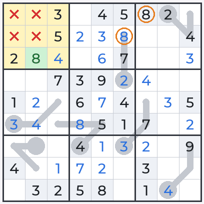

<!-- Written by tools/walkthrough.py thermo: edit the script, not this page. -->
# Thermo, step 23: the 8 in box 1

**Step 23 of 53** · [← Step 22](step-22.md) · [All steps](../thermo.md#the-whole-puzzle-step-by-step) · [Step 24 →](step-24.md)

Box 1 needs an 8. r1c1 and r1c2: row 1 has one (r1c7). r2c1 and r2c2: row 2 has one (r2c6). Only **r3c2** is left: **r3c2 = 8**.

**Step 23 of 53** · [← Step 22](step-22.md) · [All steps](../thermo.md#the-whole-puzzle-step-by-step) · [Step 24 →](step-24.md)
