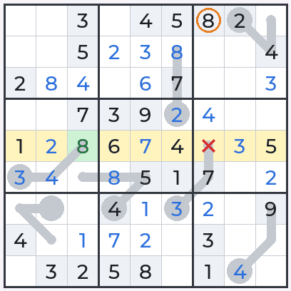

<!-- Written by tools/walkthrough.py thermo: edit the script, not this page. -->
# Thermo, step 24: the 8 in row 5

**Step 24 of 53** · [← Step 23](step-23.md) · [All steps](../thermo.md#the-whole-puzzle-step-by-step) · [Step 25 →](step-25.md)

Row 5 needs an 8. r5c7: column 7 has one (r1c7). Only **r5c3** is left: **r5c3 = 8**.

**Step 24 of 53** · [← Step 23](step-23.md) · [All steps](../thermo.md#the-whole-puzzle-step-by-step) · [Step 25 →](step-25.md)
