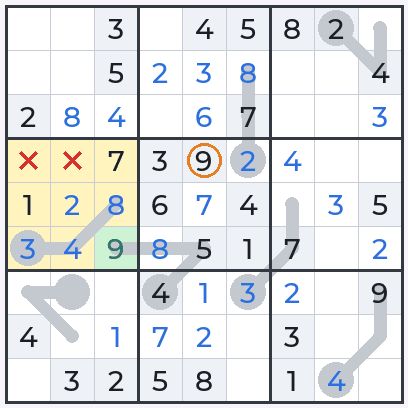

<!-- Written by tools/walkthrough.py thermo: edit the script, not this page. -->
# Thermo, step 25: the 9 in box 4

**Step 25 of 53** · [← Step 24](step-24.md) · [All steps](../thermo.md#the-whole-puzzle-step-by-step) · [Step 26 →](step-26.md)

Box 4 needs a 9. r4c1 and r4c2: row 4 has one (r4c5). Only **r6c3** is left: **r6c3 = 9**.

**Step 25 of 53** · [← Step 24](step-24.md) · [All steps](../thermo.md#the-whole-puzzle-step-by-step) · [Step 26 →](step-26.md)
