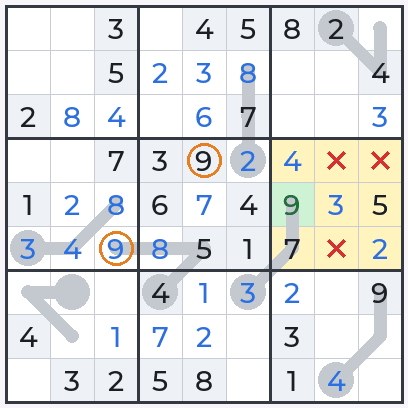

<!-- Written by tools/walkthrough.py thermo: edit the script, not this page. -->
# Thermo, step 26: the 9 in box 6

**Step 26 of 53** · [← Step 25](step-25.md) · [All steps](../thermo.md#the-whole-puzzle-step-by-step) · [Step 27 →](step-27.md)

Box 6 needs a 9. r4c8 and r4c9: row 4 has one (r4c5). r6c8: row 6 has one (r6c3). Only **r5c7** is left: **r5c7 = 9**.

**Step 26 of 53** · [← Step 25](step-25.md) · [All steps](../thermo.md#the-whole-puzzle-step-by-step) · [Step 27 →](step-27.md)
