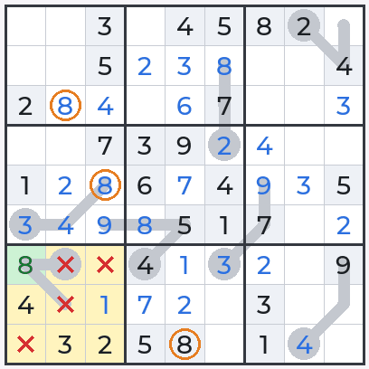

<!-- Written by tools/walkthrough.py thermo: edit the script, not this page. -->
# Thermo, step 27: the 8 in box 7

**Step 27 of 53** · [← Step 26](step-26.md) · [All steps](../thermo.md#the-whole-puzzle-step-by-step) · [Step 28 →](step-28.md)

Box 7 needs an 8. r7c2 and r8c2: column 2 has one (r3c2). r7c3: column 3 has one (r5c3). r9c1: row 9 has one (r9c5). Only **r7c1** is left: **r7c1 = 8**.

**Step 27 of 53** · [← Step 26](step-26.md) · [All steps](../thermo.md#the-whole-puzzle-step-by-step) · [Step 28 →](step-28.md)
