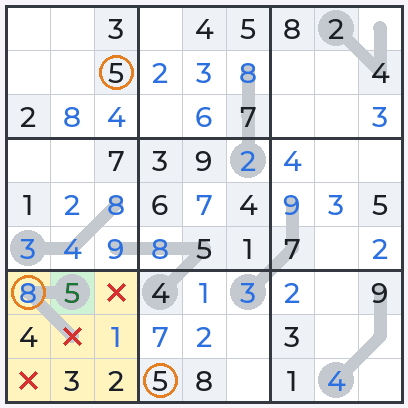

<!-- Written by tools/walkthrough.py thermo: edit the script, not this page. -->
# Thermo, step 28: the 5 in box 7

**Step 28 of 53** · [← Step 27](step-27.md) · [All steps](../thermo.md#the-whole-puzzle-step-by-step) · [Step 29 →](step-29.md)

Box 7 needs a 5. r7c3: column 3 has one (r2c3). r9c1: row 9 has one (r9c4). r8c2: it comes after the 8 in r7c1 on its thermometer, so it's above 8. Only **r7c2** is left: **r7c2 = 5**.

**Step 28 of 53** · [← Step 27](step-27.md) · [All steps](../thermo.md#the-whole-puzzle-step-by-step) · [Step 29 →](step-29.md)
